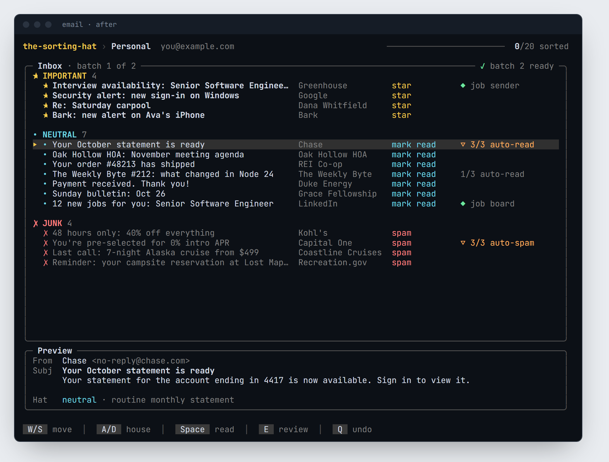
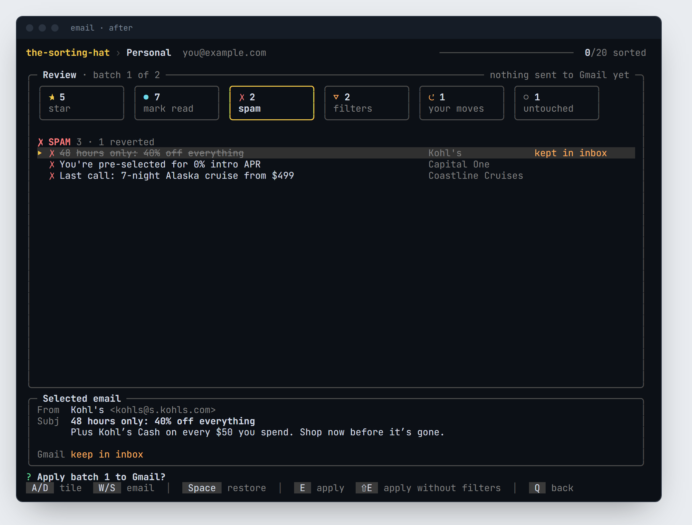

# 🎩 the-sorting-hat

> *"Hmm, difficult. Very difficult. Plenty of courage, I see. Not a bad mind, either. There's talent — oh yes — and a thirst to prove yourself. But where to put you?"*

The Sorting Hat for your inbox. A local-first Gmail triage CLI that reads your unread emails, runs them through a local LLM, and sorts them into three houses:

| House | Emails |
|-------|--------|
| ⭐ **Important** | Recruiters, real humans, security alerts, confirmed bookings |
| · **Neutral** | Statements, receipts, newsletters, HOA drama |
| ✗ **Junk** | Sales. So much sales. |

No data leaves your machine. The LLM runs locally via Ollama.

---

## Requirements

- [Node.js](https://nodejs.org) v18+
- [Ollama](https://ollama.com) running locally with `qwen2.5-coder:14b` pulled (~9 GB; a GPU with 12 GB+ VRAM keeps it fast)
- A Google Cloud project with the Gmail API enabled

---

## Setup

### 1. Clone & install

```bash
git clone https://github.com/nlewis84/the-sorting-hat.git
cd the-sorting-hat
npm install
```

### 2. Pull the model

```bash
ollama pull qwen2.5-coder:14b
```

On a smaller machine, use the lighter (less accurate) model instead by setting `QWEN_MODEL`:

```bash
ollama pull qwen2.5-coder:1.5b
QWEN_MODEL=qwen2.5-coder:1.5b node index.js
```

### 3. Google credentials

1. Go to [Google Cloud Console](https://console.cloud.google.com)
2. Create a project → enable the **Gmail API**
3. Create an **OAuth 2.0 Client ID** (Desktop app type)
4. Download the JSON and save it as `credentials.json` in the project root

Use `credentials.example.json` as a reference for the expected shape.

### 4. Configure your accounts

Copy `accounts.example.json` → `accounts.json` and fill in your details:

```json
[
  {
    "id": "personal",
    "name": "Personal",
    "email": "you@gmail.com",
    "credentialsFile": "credentials.json",
    "tokenFile": "token-personal.json"
  }
]
```

Each account can share one `credentialsFile` or use separate ones. `tokenFile` is created automatically on first run.

### 5. Add a shell alias

```bash
alias email='node /path/to/the-sorting-hat/index.js'
```

---

## Usage

Make sure Ollama is running first:

```bash
ollama serve
```

Then in a separate terminal (or if Ollama is already running as a background service):

```bash
email
```

The terminal clears, a banner appears, you pick an account, and the hat goes to work.

**First run:** a browser window opens for the Google OAuth flow. After that, tokens are cached locally.

### Batch review

Emails come in batches of 15, and each batch gets one full screen: every email sorted into its house, with a preview of the selected one and the hat's reason for its pick.



The controls sit under a resting WASD hand:

| Key | In the list | On the review screen |
|-----|-------------|----------------------|
| `W` / `S` | Move up / down (`Shift` jumps between houses) | Pick an email |
| `A` / `D` | Move the email toward important / toward junk | Pick a tile |
| `1` `2` `3` | Put it straight into important / neutral / junk | |
| `Space` | Toggle read | Revert the selected change (again to restore) |
| `E` | Review the batch (`Shift+E` opens the email in Gmail) | Apply (`Shift+E` applies without creating filters) |
| `Q` | Undo the last applied batch (`Shift+Q` quits) | Back to the list |

Nothing touches Gmail until you press `E` on the review screen. It shows every change as a tile (stars, reads, spam, new filters, your corrections), and you can revert any single change from there.



`Q` undoes the last applied batch: stars, read state and spam moves are reversed, and any filter that batch created is deleted. The session ends with a summary of everything that changed.

### Learning

The hat remembers. Each correction and each sender you mark read or send to spam is tracked in `learning.json`, and the list shows how close a sender is (`2/3 auto-read`). The third time, the review screen shows the Gmail filter it's about to create, and you can skip it. Job senders and job boards are never filtered.

### Tests

```bash
npm test
```

---

## What's not pushed to GitHub

```
credentials.json        # your OAuth client secret
token-*.json            # your live access tokens
accounts.json           # your email addresses
learning.json           # your filter history
```

All of these are in `.gitignore`. Do not commit them.

---

*"Not Slytherin, not Slytherin... JUNK!"*
